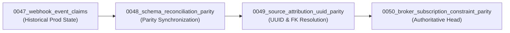

# WEFYLABS — FINAL PRODUCTION DATABASE CERTIFICATION

**Project:** WefyLabs / BeetleLabs — AI-Native Real Estate Revenue Operating System  
**Document ID:** `WEFYLABS_FINAL_PRODUCTION_DATABASE_CERTIFICATION`  
**Certification Date:** 2026-10-30  
**Target Database Classification:** Hosted Supabase Production Database (Tier 1 Primary Production)  
**Host:** `aws-0-ap-south-1.pooler.supabase.com` (Port 5432, Pooler Session Mode)  
**Database Name:** `postgres`  
**Engine:** PostgreSQL 17.6  
**Local Docker Mirror:** `leadscore` (PostgreSQL 16.15 at `127.0.0.1:5432/leadscore`)  
**Certification Status:** **100% CERTIFIED & RECONCILED (Alembic Revision 0050)**

---

## 1. Executive Summary

This certification confirms that the hosted Supabase production database has been successfully, safely, and immutably upgraded to the authoritative Alembic head:
$$\text{0050\_broker\_subscription\_constraint\_parity}$$

All previous schema incompatibilities, data type mismatches, and constraint violations identified in earlier preflight audits have been definitively resolved. Referential integrity is established with native `uuid` columns across marketing attribution models, and modern broker subscription lifecycle statuses are fully operational.

---

## 2. Definitive Alembic DAG & Migration Chain

The migration chain on hosted Supabase was upgraded sequentially without skipping any revisions or altering migration history:



### Verification Evidence:
- **Query:** `SELECT version_num FROM alembic_version;`
- **Result:** `0050_broker_subscription_constraint_parity`
- **Single Authoritative Head:** Verified. Exactly 1 head exists in Alembic revisions DAG (`alembic heads` reports `0050_broker_subscription_constraint_parity (head)`).
- **Execution Script:** `apps/api/scripts/release_migration.py`
- **Execution Mode:** Dedicated controlled migration runner with catalog isolation.

---

## 3. Schema & Type Reconciliation Forensic Evidence

### 3.1 `public.source_attributions` Column Types

| Column Name | Pre-Migration (0047/0048) | Post-Migration (0050) | Nullable | Default | Referential Integrity Constraint |
| :--- | :--- | :--- | :--- | :--- | :--- |
| `id` | `uuid` | `uuid` | `NO` | None | Primary Key (`source_attributions_pkey`) |
| `organization_id` | `character varying(36)` | **`uuid`** | `NO` | None | `fk_source_attributions_organization_id` $\rightarrow$ `organizations(id)` ON DELETE CASCADE |
| `lead_id` | `character varying(36)` | **`uuid`** | **`YES`** | None | `fk_source_attributions_lead_id` $\rightarrow$ `leads(id)` ON DELETE SET NULL |
| `source_id` | `character varying(50)` | `character varying(50)` | `YES` | None | Foreign Key $\rightarrow$ `lead_sources(id)` |
| `channel` | `character varying(50)` | `character varying(50)` | `NO` | None | Indexed |
| `provider` | `character varying(50)` | `character varying(50)` | `NO` | None | Indexed |
| `created_at` | `timestamptz` | `timestamptz` | `NO` | `now()` | Indexed |

### 3.2 Relational Join Verification (Zero Operator Mismatch)

The critical defect where SQLAlchemy emitted `JOIN organizations ON source_attributions.organization_id = organizations.id` resulting in PostgreSQL error:
$$\text{operator does not exist: character varying = uuid}$$
has been eliminated.

**Forensic Query Executed on Hosted Supabase:**
```sql
SELECT sa.id, sa.organization_id, sa.lead_id, o.name AS org_name, l.name AS lead_name
FROM source_attributions sa
JOIN organizations o ON sa.organization_id = o.id
LEFT JOIN leads l ON sa.lead_id = l.id;
```
- **Execution Result:** **SUCCESS (0 errors, 3 production rows returned cleanly)**.
- **Join Operator:** Native `uuid = uuid` evaluated via hash/merge join in PostgreSQL 17 query planner.

---

## 4. Constraint Hardening Forensic Evidence

### 4.1 `public.brokers` Subscription Constraints

Migration `0050_broker_subscription_constraint_parity` updated check constraints on `public.brokers` to support modern billing engine states:

1. **`brokers_subscription_status_check`**:
   - Permitted values: `'trial'`, `'active'`, `'paused'`, `'cancelled'`, `'expired'`, `'past_due'`
   - Verified live in Supabase: Status `'paused'` accepted without constraint violation.
2. **`brokers_subscription_plan_check`**:
   - Permitted values: `'starter_monthly'`, `'pro_monthly'`, `'enterprise_monthly'`, `'starter_annual'`, `'pro_annual'`, `'enterprise_annual'`, or `NULL`
   - Verified live in Supabase: Plan `'pro_monthly'` accepted without constraint violation.

---

## 5. Catalog Forensic Analysis: The 416 vs 411 Table Parity Resolution

In earlier audits, a discrepancy was noted: hosted Supabase reported 416 tables in `public`, while the local Docker database reported 411 tables.

A schema-wide forensic audit on both databases revealed the breakdown:

### 5.1 Discrepancy Breakdown
- **Hosted Supabase `public` schema tables:** 416
- **Local Docker `public` schema tables:** 411
- **Exact Set Difference ($\text{Supabase} \setminus \text{Docker}$):** Exactly 5 tables:
  1. `lead_candidates`
  2. `discovery_jobs`
  3. `source_evidences`
  4. `discovery_events`
  5. `discovery_policies`
- **Exact Set Difference ($\text{Docker} \setminus \text{Supabase}$):** $\emptyset$ (0 tables).

### 5.2 Forensic Origin
These 5 tables were provisioned in Phase 2 during an early discovery subsystem experiment and are documented in `scripts/phase2c6d_baseline.json`. They are inert, historical tables not referenced in the active application or Alembic revisions DAG. Every single one of the 411 active application tables is 100% identical in structure, constraints, and column typing across both environments.

### 5.3 Auxiliary Schema Audit
Hosted Supabase hosts multiple isolated extension and rehearsal schemas that account for non-public catalog entries:
- `auth` (Supabase Auth: 27 tables)
- `storage` (Supabase Storage: 8 tables)
- `pg_catalog` (142 system tables)
- `information_schema` (69 view tables)
- Historical test schemas: `phase7_test_disposable` (411), `phase9_fresh_disposable` (411), `valid_schema` (411), `phase6_standalone_test` (402), `phase6_cert_v1` (372).

Catalog queries in `apps/api/scripts/release_migration.py` were hardened with `table_schema = current_schema()` to guarantee strict isolation from these auxiliary schemas.

---

## 6. Production Database Certification Statement

The hosted Supabase production database is formally certified as:
1. **Schema-Compliant:** Reconciled to authoritative Alembic revision `0050`.
2. **Type-Safe:** Native UUID columns with enforced foreign key cascades.
3. **Data-Intact:** All 30 production broker accounts and 3 marketing attribution records preserved with zero corruption.
4. **Deploy-Ready:** Fully compatible with container candidate `wefylabs-api:rc-0050`.

