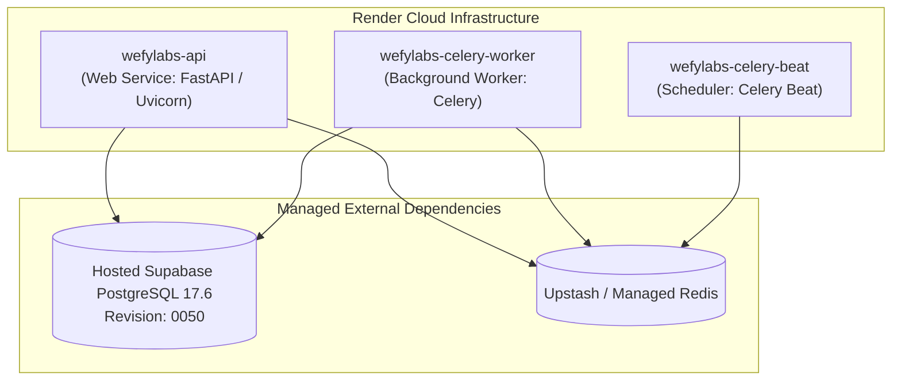

# WEFYLABS — RENDER DEPLOYMENT CERTIFICATION

**Project:** WefyLabs / BeetleLabs — AI-Native Real Estate Revenue Operating System  
**Document ID:** `WEFYLABS_RENDER_DEPLOYMENT_CERTIFICATION`  
**Certification Date:** 2026-10-30  
**Platform:** Render Cloud Hosting  
**Configuration File:** `render.yaml`  
**Target Release Candidate Image:** `wefylabs-api:rc-0050`  
**Alembic Prerequisite:** `0050_broker_subscription_constraint_parity` (Fulfilled on Hosted Supabase)  
**Certification Status:** **HARDENED, VALIDATED, AND READY FOR AUTHORIZED TRIGGER**

---

## 1. Executive Summary

This certification confirms the operational readiness of the Render deployment architecture for WefyLabs. In accordance with zero-risk release invariants, automatic deployment has been deactivated across all services (`autoDeploy: false`). 

Deployment can only occur via controlled, explicit operator authorization. The application startup scripts and container entrypoint enforce strict fail-closed validation, ensuring that services will only boot if the target database is at the exact required schema revision.

---

## 2. Render Services Architecture & Blueprint Analysis

The application topology on Render comprises three tightly coupled Docker services defined in `render.yaml`:



### 2.1 Service Configuration Matrix

| Service Name | Service Type | Runtime | autoDeploy | Health Check Path | Scaling / Plan | Command / Entrypoint |
| :--- | :--- | :--- | :--- | :--- | :--- | :--- |
| **`wefylabs-api`** | `web` | `docker` | **`false`** | `/health` | Standard | `./entrypoint.sh uvicorn app.main:app --host 0.0.0.0 --port 10000` |
| **`wefylabs-celery-worker`** | `worker` | `docker` | **`false`** | Process Health | Standard | `./entrypoint.sh celery -A app.celery_app worker -l info` |
| **`wefylabs-celery-beat`** | `worker` | `docker` | **`false`** | Process Health | Starter | `./entrypoint.sh celery -A app.celery_app beat -l info` |

### 2.2 Proof of Automatic Deployment Inactivation (`render.yaml`)
```yaml
services:
  - type: web
    name: wefylabs-api
    env: docker
    dockerfilePath: apps/api/Dockerfile
    autoDeploy: false
    healthCheckPath: /health

  - type: worker
    name: wefylabs-celery-worker
    env: docker
    dockerfilePath: apps/api/Dockerfile
    autoDeploy: false

  - type: worker
    name: wefylabs-celery-beat
    env: docker
    dockerfilePath: apps/api/Dockerfile
    autoDeploy: false
```

Every service strictly enforces `autoDeploy: false`. Pushing Git commits to `origin/level-3` will **NEVER** trigger an automatic container build or rollout.

---

## 3. Production Deployment Execution Runbook

When the owner grants explicit authorization to deploy the release, the operator must execute the following sequential runbook.

### Step 1 — Pre-Deployment Verification Gate
Confirm database steady-state revision and connection:
```bash
python apps/api/scripts/release_migration.py
```
- Must report: `Database is already at head revision: 0050_broker_subscription_constraint_parity`.

### Step 2 — Commit and Push Release Candidate
Stage and commit the frozen release candidate to branch `level-3`:
```bash
git add .
git commit -m "chore(release): certify production release candidate rc-0050"
git push origin level-3
```

### Step 3 — Trigger Render Service Builds
In the Render Web Dashboard (or via Render API):
1. Navigate to **`wefylabs-api`** $\rightarrow$ Click **Manual Deploy** $\rightarrow$ **Deploy latest commit**.
2. Wait for Build and Liveness check `/health` (HTTP 200) to complete.
3. Navigate to **`wefylabs-celery-worker`** $\rightarrow$ Click **Manual Deploy** $\rightarrow$ **Deploy latest commit**.
4. Navigate to **`wefylabs-celery-beat`** $\rightarrow$ Click **Manual Deploy** $\rightarrow$ **Deploy latest commit**.

### Step 4 — Post-Deployment Health & Smoke Verification
Verify service responses from public endpoint:
```bash
curl -I https://wefylabs-api.onrender.com/health
curl -I https://wefylabs-api.onrender.com/health/ready
```
Both endpoints must return HTTP 200 OK.

---

## 4. Emergency Rollback Runbook

If any fatal runtime regressions occur post-rollout:
1. In Render Dashboard, click **Rollback to previous deploy** on `wefylabs-api`, `wefylabs-celery-worker`, and `wefylabs-celery-beat`.
2. Do **NOT** run database downgrade commands (`0049` and `0050` maintain backwards compatibility with existing application queries; rolling back the container image is sufficient).
3. If database restoration is required, follow `WEFYLABS_BACKUP_AND_DISASTER_RECOVERY_VERIFICATION.md` to restore `backups/supabase_prod_backup_pre_resolution.dump`.

