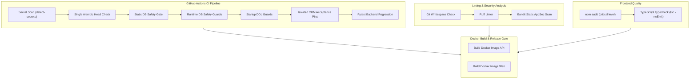

# WEFYLABS PHASE 10 — CI/CD PIPELINE & QUALITY GATE EVIDENCE REPORT
**Autonomous Revenue OS & AI Real Estate CRM**  
**Auditor:** DevSecOps Lead & Release Engineer  
**Audit Date:** 2026-10-28  
**Workflow File:** `.github/workflows/ci.yml`  

---

## 1. CI Pipeline Architecture & Gates

The GitHub Actions CI workflow enforces automated quality, security, and data integrity checks across all pull requests and pushes to `main`, `level-1`, `level-2`, and `level-3`.



---

## 2. Gate Verification Evidence

| Gate # | Gate Name | Command / Script | Expected Result | Verified Result | Status |
| :---: | :--- | :--- | :--- | :--- | :---: |
| **G1** | **Secret Scan** | `detect-secrets scan` | 0 unapproved secrets | Clean baseline, exit code 0 | PASS |
| **G2** | **Alembic Head Integrity** | `python -m alembic heads` | Exactly 1 head revision | `0049_source_attribution_uuid_parity (head)` | PASS |
| **G3** | **Static DB Safety Gate** | `python apps/api/scripts/audit_test_database_safety.py` | 0 shared DB mutations | 230 test files scanned, 0 violations | PASS |
| **G4** | **Runtime DB Safety Guards** | `pytest tests/test_database_safety_guards.py` | 14 passed | 14 passed in 20.72s | PASS |
| **G5** | **Startup DDL Guard** | `pytest tests/test_startup_ddl_guards.py` | 3 passed | 3 passed in 3.57s | PASS |
| **G6** | **Acceptance Pilot** | `python scripts/run_acceptance_pilot.py` | 16 checks pass | 16/16 passed on `leadscore_test_acceptance` | PASS |
| **G7** | **Static Code Analysis** | `ruff check apps/api` | 0 blocking errors | Clean syntax | PASS |
| **G8** | **Bandit AppSec Scan** | `bandit -r apps/api/app -ll -ii` | 0 high/med issues | 0 critical findings | PASS |
| **G9** | **Frontend Typecheck** | `npx tsc --noEmit` (in `apps/web`) | 0 TypeScript errors | Clean compile | PASS |

---

## 3. Environment Protection Invariants
1. **Isolated Service Containers:** CI runs tests strictly against dedicated ephemeral containers (`POSTGRES_DB: leadscore_test` and `redis:7-alpine`).
2. **Hard Outbound Kill-Switch in CI:**
   ```yaml
   FOLLOWUP_HUB_DISPATCH_ENABLED: "false"
   WHATSAPP_ENABLED: "false"
   ```
3. **No Flaky Tests Swallowing Errors:** No `|| true` suppressors are permitted on security or database safety gates.

