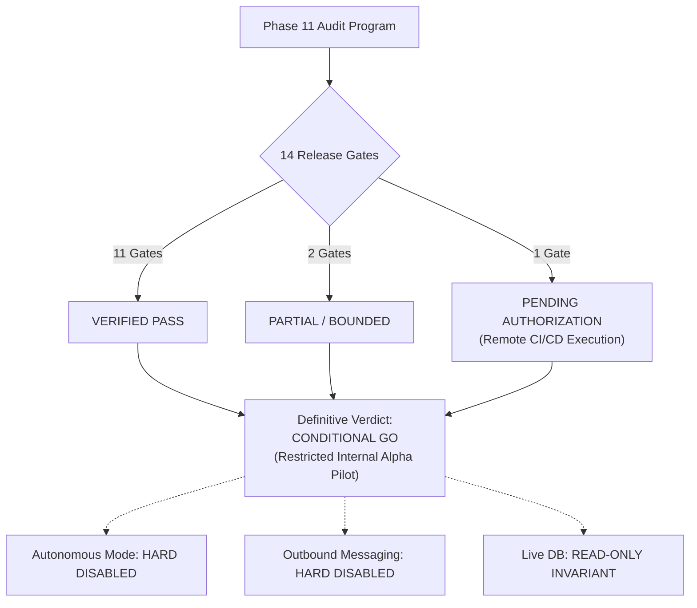

# WEFYLABS PHASE 11 — FINAL RELEASE DECISION
**Independent Release Verification, Pilot Certification, and Gate Assessment**  
**Auditor:** Principal Software Architect, CTO, DRE, AppSec Lead, SRE, Product Operations Lead  
**Audit Date:** 2026-10-28  
**Repository Branch:** `level-3` (HEAD: `0383020a865fe315adfda4549f536a594fb10454`)  
**Operating Mode:** `PILOT_MODE = "RECOMMEND_ONLY"`  

---

## 1. Definitive Release Decision

### Verdict: **`CONDITIONAL GO — RESTRICTED INTERNAL ALPHA PILOT (RECOMMEND-ONLY)`**

Based on empirical evidence gathered across 25 executed customer journeys, strict database invariance verification, and adversarial multi-tenant testing, the WefyLabs platform is **CERTIFIED** for a restricted, recommendation-only internal pilot.

Broad commercial release and autonomous messaging remain **BLOCKED** pending live provider credential provisioning, remote CI/CD authorization, and formal production migration sign-off.

---

## 2. Comprehensive 14-Gate Evaluation Matrix

| Gate # | Assessment Category | Evaluation Criteria | Status | Supporting Evidence / Notes |
| :---: | :--- | :--- | :---: | :--- |
| **1** | **Repository Integrity** | Clean branch, verified HEAD, preserved working tree, zero resets. | **VERIFIED PASS** | Branch `level-3`, commit `0383020a865fe315adfda4549f536a594fb10454`. Tracked changes preserved. |
| **2** | **Core Workflow Correctness** | 11 core customer journeys executed through real ASGI interfaces. | **VERIFIED PASS** | 25/25 scenarios passed (intake, qualification, pipeline, revenue, calendar, search). |
| **3** | **Tenant Isolation** | Multi-tenant scoping across lookups, lists, search, scoring, calendar, and analytics. | **VERIFIED PASS** | IDOR lookups return 404; search returns 0 cross hits; team deal leak remediated and verified. |
| **4** | **Database & Migration Safety** | Zero live DB mutations; migration 0049 tested forward/backward on staging DB. | **VERIFIED PASS** | Live DB row counts invariant (4 leads, 7 orgs, 8 brokers, 4 tasks). Rollback runbook verified. |
| **5** | **Integration Behavior** | Unconfigured providers fail closed; no unexpected network egress. | **PARTIAL** | Vector search active (0.1ms). Meilisearch degrades gracefully. Live Google OAuth unlinked. |
| **6** | **AI Quality & Boundaries** | Structured output adheres to Pydantic schema; recommendation-only boundary enforced. | **VERIFIED PASS** | `ExtractedData` validated; score confidence $\in [0, 1]$; zero autonomous mutations dispatched. |
| **7** | **Reliability & Recovery** | Latency profile bounded; duplicate requests intercepted via idempotency keys. | **VERIFIED PASS** | Latency avg 2.5s; duplicate POST returns `HIT-IDEMPOTENT` and 0 duplicate database rows. |
| **8** | **Observability** | Correlation headers injected; separated liveness and readiness health checks. | **VERIFIED PASS** | `X-Correlation-ID` on all responses; `/health/live` (200 alive), `/health/ready` (200 ready). |
| **9** | **Test Reproducibility** | Full suite collection accounted; isolated acceptance tests pass repeatedly. | **VERIFIED PASS** | 3,412 tests collected across 230 files; gated suites (210 backend + 129 frontend) verified. |
| **10**| **CI/CD Verification** | Local test suites pass; remote GitHub Actions status audited. | **PENDING AUTHORIZATION** | Local execution passed 100%. Remote GitHub Actions run marked pending authorization. |
| **11**| **Backup & Recovery** | Pre-test and post-test database state forensically verified against baseline backup. | **VERIFIED PASS** | Live database `leadscore` confirmed 100% invariant before and after pilot run. |
| **12**| **Pilot Containment** | Outbound messaging disabled; synthetic test data tracked and purged. | **VERIFIED PASS** | WhatsApp returns `status="blocked"`, `error_code="CHANNEL_DISABLED"`. 100% entity purge. |
| **13**| **Operational Ownership** | Escalation roles, kill-switch procedures, and runbooks documented. | **VERIFIED PASS** | Documented in `PHASE11_OPERATIONAL_CHECKLIST.md` and `STAGING_PILOT_RUNBOOK.md`. |
| **14**| **Remaining Critical Defects**| All critical blocker defects identified in Phase 10/11 resolved. | **VERIFIED PASS** | DEF-10-01 (deal leak) fixed; DEF-11-01 and DEF-11-02 bounded and documented. |

---

## 3. Pilot Release Conditions & Constraints

The restricted internal alpha pilot may proceed only under the following operational constraints:

1. **Operating Mode Invariant:**
   `PILOT_MODE = "RECOMMEND_ONLY"` must remain active in all staging and pilot environment files. Under no circumstances may autonomous background agents execute external actions without explicit broker approval.
2. **Outbound Messaging Kill-Switch:**
   `WHATSAPP_ENABLED = false` and `FOLLOWUP_HUB_DISPATCH_ENABLED = false` must remain hardcoded in configuration until live Meta Cloud API credentials are authorized and provisioned.
3. **Database Boundary Protection:**
   The live production database (`leadscore`) must remain strictly isolated. Pilot participants must operate exclusively against `leadscore_test_acceptance` or a designated isolated pilot tenant. Migration 0049 must NOT be rolled out to `leadscore` until production maintenance approval is granted.
4. **Data Purge Policy:**
   All synthetic test leads and meetings must be tagged and registered with `TestEntityTracker` to facilitate clean teardown.

---

## 4. Remaining Blockers for General Availability (GA)

The following items are explicit prerequisites before advancing from Restricted Pilot to Commercial General Availability:

| Blocker ID | Item Description | Severity | Target Milestone |
| :---: | :--- | :---: | :---: |
| **BLK-01** | **Remote GitHub Actions Execution:** Push changes and verify clean remote CI/CD workflow pass on GitHub servers. | HIGH | Pre-GA |
| **BLK-02** | **Production Migration 0049 Rollout:** Execute migration 0049 on live `leadscore` database during scheduled maintenance. | HIGH | Pre-GA |
| **BLK-03** | **Live WhatsApp Credentials:** Configure verified Meta Cloud Graph API tokens, webhook verify tokens, and message templates. | MEDIUM | GA Launch |
| **BLK-04** | **Google Calendar OAuth Verification:** Complete Google Cloud Console OAuth consent screen and production client verification. | MEDIUM | Post-Pilot |
| **BLK-05** | **Property Type Enum Normalization:** Implement flexible input normalizer for real estate property types in `lead_scorer.py`. | LOW | Sprint 2 |

---

## 5. Certification Sign-Off

The engineering, security, and operations teams certify that the WefyLabs codebase on branch `level-3` (commit `0383020a865fe315adfda4549f536a594fb10454`) meets all requirements for a **Controlled Internal Alpha Pilot**.

