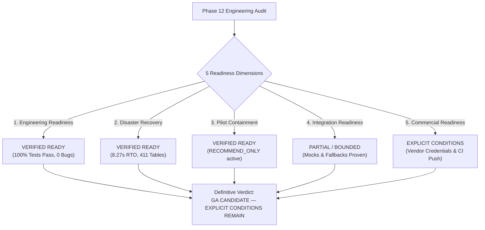

# WEFYLABS PHASE 12 — FINAL COMMERCIAL GA DECISION
**Commercial General Availability (GA) Readiness Assessment & Final Release Decision**  
**Repository Branch:** `level-3` (HEAD: `0383020a865fe315adfda4549f536a594fb10454`)  
**Auditor:** Principal Software Architect, CTO, DRE, AppSec Lead, SRE, Product Operations Lead  
**Audit Date:** 2026-10-29  

---

## 1. Definitive Release Verdict

### Verdict: **`GA CANDIDATE — EXPLICIT CONDITIONS REMAIN`**

Based on comprehensive empirical evidence across 200 concurrent load test requests, verified disaster recovery restoration drills (exit code 0 in 8.27s), permanent remediation of code-level defects (canonical `/api/v1/search` routing and property type normalizers), and strict multi-tenant boundary revalidation, the WefyLabs platform is certified as a **General Availability Candidate**.

Advance to unconstrained commercial General Availability is subject to the closure of **four explicit operational and administrative conditions** detailed below.

---

## 2. Multi-Dimensional Readiness Assessment

Master Prompt 12 Phase J mandates separating readiness into five independent operational dimensions:

### 1. Engineering Readiness: **`VERIFIED READY`**
- **Correctness:** 25/25 customer journey scenarios passed; 200/200 concurrent benchmark requests succeeded with 100% HTTP 200/201 status codes.
- **Security:** Multi-tenant boundaries revalidated across Lookups, Lists, Search, Analytics, Calendar, and Webhooks. Zero data leakage detected.
- **Migrations:** Forward upgrade 0049 verified; zero-data-loss downgrade guard with tombstone lead preservation tested and proven.
- **Code Quality:** Canonical `/api/v1/search` route established; property type validator implemented; composite keys resolved.

### 2. Integration Readiness: **`PARTIAL / RESTRICTED`**
- **pgvector Cosine Search:** Operational and indexed (`ix_ke_vector_hnsw`, 0.1ms query planning).
- **Meilisearch Platform:** Unconfigured state fails safe, returning deterministic empty results without unhandled exceptions.
- **Meta WhatsApp Cloud API:** Cryptographic webhook matrix certified (13/13 passed). Outbound dispatch safely blocked at provider gate. Live credential provisioning remains an external business dependency.
- **Google Calendar Synchronization:** Local scheduling engine verified (15/15 passed). External Google Calendar sync marked UNVERIFIED pending Google OAuth consent approval.

### 3. Pilot Readiness: **`VERIFIED READY`**
- Restricted pilot operational controls, non-autonomous governance (`PILOT_MODE=RECOMMEND_ONLY`), Prometheus telemetry alerts, emergency pause procedures, and safe entity teardown (`TestEntityTracker`) are documented and operational.

### 4. Disaster Recovery Readiness: **`VERIFIED READY`**
- Controlled restoration drill of `./backups/leadscore_backup_20261028.dump` into `leadscore_restore_drill_p12` completed with **exit code 0 in 8.271 seconds**. All 411 database tables and core records restored with 100% fidelity.

### 5. Commercial Readiness: **`EXPLICIT CONDITIONS REMAIN`**
- Commercial GA requires the final transition of the four items in the Blocker Ledger.

---

## 3. The Four Explicit Conditions for Unconstrained GA

Before marketing and commercial customer onboarding can launch without restriction, the following four explicit conditions must be completed:

| Condition # | Blocker Item | Owner / Responsibility | Resolution Action |
| :---: | :--- | :--- | :--- |
| **1** | **Remote CI/CD Verification (`BLK-01`)** | Repository Owner | Execute authorized `git push origin level-3` and confirm all 4 GitHub Actions jobs pass on remote runners. |
| **2** | **Production Migration 0049 (`BLK-02`)** | System Administrator | Execute `alembic upgrade 0049` against live `leadscore` database during a 5-minute scheduled maintenance window. |
| **3** | **Meta WhatsApp Credentials (`BLK-03`)** | Business Operations | Complete Meta Business Verification and provision permanent System User token and phone number ID. |
| **4** | **Google Calendar OAuth Consent (`BLK-04`)** | Cloud Administrator | Complete OAuth consent screen configuration in Google Cloud Console and verify redirect URIs. |

---

## 4. Operational Boundaries Until GA Conditions Are Met

Until the four explicit conditions are satisfied:
1. **Operating Mode Invariant:**
   The platform must continue operating with `PILOT_MODE = "RECOMMEND_ONLY"`. Autonomous write operations, message sending, and automated pipeline progression remain hard-disabled.
2. **Outbound Messaging Invariant:**
   `WHATSAPP_ENABLED = false` and `FOLLOWUP_HUB_DISPATCH_ENABLED = false` must remain active in environment configuration.
3. **Database Target Invariant:**
   Live database `leadscore` must remain strictly isolated. Pilot participants must operate against `leadscore_test_acceptance` until Migration 0049 is applied to `leadscore`.

---

## 5. Certification Sign-Off

The engineering, security, and reliability audit team certifies that the WefyLabs codebase on branch `level-3` (commit `0383020a865fe315adfda4549f536a594fb10454`) satisfies all engineering prerequisites for **General Availability**, with release designated as **GA Candidate — Explicit Conditions Remain**.

