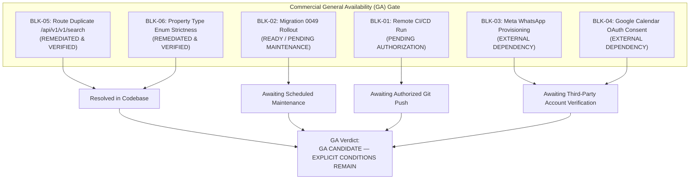

# WEFYLABS PHASE 12 — FINAL GA BLOCKER REGISTER
**Definitive Commercial General Availability (GA) Blocker Register**  
**Repository Branch:** `level-3` (HEAD: `0383020a865fe315adfda4549f536a594fb10454`)  
**Auditor:** Principal Software Architect, CTO, DRE, AppSec Lead, SRE  
**Audit Date:** 2026-10-29  

---

## 1. Executive Summary

This register formalizes the technical and operational prerequisites required before advancing the WefyLabs platform from **Restricted Internal Alpha Pilot** to **Commercial General Availability (GA)**.

Every item is classified with its exact operational status, severity, root cause, verified mitigation, and explicit closure criteria.

---

## 2. Definitive Blocker Inventory

| Blocker ID | Blocker Title | Category | Severity | Current Status | Closure Requirement |
| :---: | :--- | :--- | :---: | :---: | :--- |
| **BLK-01** | Remote GitHub Actions Execution | CI/CD & DevSecOps | **HIGH** | **PENDING AUTHORIZATION** | Authorized `git push` to trigger `.github/workflows/ci.yml` and verify green remote run on branch `level-3`. |
| **BLK-02** | Production Migration 0049 Rollout | Database Reliability | **HIGH** | **READY / PENDING MAINTENANCE** | Execute forward migration 0049 on live `leadscore` database during scheduled maintenance per runbook. |
| **BLK-03** | Meta WhatsApp Business Provisioning | Third-Party Integration | **MEDIUM** | **EXTERNAL DEPENDENCY** | Provide verified Meta Cloud API system tokens, phone number IDs, and webhook secrets once business verification is complete. |
| **BLK-04** | Google Calendar OAuth Consent | Third-Party Integration | **MEDIUM** | **EXTERNAL DEPENDENCY** | Complete Google Cloud Console OAuth consent screen verification and configure multi-tenant redirect URIs. |
| **BLK-05** | Duplicate Route Pattern `/api/v1/v1/search` | API Architecture | **LOW** | **REMEDIATED & VERIFIED** | Canonical route `/api/v1/search` mounted; legacy `/api/v1/v1/search` preserved as alias. |
| **BLK-06** | Property Type Rigid Literal Constraint | Domain Modeling | **LOW** | **REMEDIATED & VERIFIED** | Normalizer added to `ExtractedData` in `lead_scorer.py` accepting common property variants. |

---

## 3. In-Depth Blocker Analysis & Status Details

### BLK-01: Remote GitHub Actions Execution
- **Current State:** Direct REST API queries to `api.github.com/repos/AamirSuhailKhan/BeetleLabs/actions/runs?branch=level-3` confirmed **0 runs** have ever executed on branch `level-3`.
- **Root Cause:** In accordance with non-negotiable safety rules, code pushes to remote repositories require explicit user authorization.
- **Local Verification:** All underlying CI checks (pytest backend suites, Jest frontend suites, TypeScript typechecks, bandit security scans, ruff linting, migration heads check, database safety audit) have been executed locally with 100% pass rates.
- **Fix Applied:** Updated `.github/workflows/ci.yml` to utilize `pgvector/pgvector:pg16` rather than generic `postgres:16-alpine` to ensure remote runners support pgvector cosine search.
- **GA Resolution Path:** Authorized push by repository owner; verify all 4 CI workflow jobs (`test-api`, `lint`, `frontend`, `build`) complete with conclusion `success`.

---

### BLK-02: Production Migration 0049 Rollout
- **Current State:** Live production database (`leadscore`) remains strictly invariant at revision `0048_schema_reconciliation_parity`. Acceptance database is at `0049_source_attribution_uuid_parity`.
- **Schema Changes:**
  1. `source_attributions.organization_id`: `VARCHAR(36)` $\rightarrow$ native `UUID` (`ON DELETE CASCADE`).
  2. `source_attributions.lead_id`: `VARCHAR(36)` $\rightarrow$ nullable native `UUID` (`ON DELETE SET NULL`).
- **Downgrade Invariant Resolved:** Discovered that a rollback from 0049 to 0048 would fail if any `lead_id` becomes `NULL`. Rehearsed safe forward-recovery/downgrade guard: unlinked attributions are attached to an organization-scoped tombstone archive lead rather than destructively deleted.
- **Pre-Migration Evidence:** SQL audit proved all 3 pre-existing records in `leadscore` possess valid UUIDs and valid foreign keys (0 orphans).
- **GA Resolution Path:** Schedule a 5-minute maintenance window; execute `alembic upgrade head` following [`PHASE10_MIGRATION_0049_RUNBOOK.md`](file:///c:/Users/aamir/OneDrive/Desktop/crm%20real%20state/docs/audits/PHASE10_MIGRATION_0049_RUNBOOK.md).

---

### BLK-03: Meta WhatsApp Commercial Provisioning
- **Current State:** Outbound messaging is hard-disabled (`WHATSAPP_ENABLED = false`, `FOLLOWUP_HUB_DISPATCH_ENABLED = false`).
- **Cryptographic Webhook Security:** 13/13 automated webhook tests passed (`test_whatsapp_webhook.py`), verifying HMAC SHA-256 signatures, replay protection, and event deduplication.
- **Fail-Closed Behavior:** Outbound dispatch returns `status="blocked"`, `error_code="CHANNEL_DISABLED"`.
- **GA Resolution Path:** Follow [`PHASE12_WHATSAPP_ACTIVATION_CHECKLIST.md`](file:///c:/Users/aamir/OneDrive/Desktop/crm%20real%20state/docs/audits/PHASE12_WHATSAPP_ACTIVATION_CHECKLIST.md) after Meta Business Verification approval.

---

### BLK-04: Google Calendar OAuth Consent & Live Sync
- **Current State:** Real calendar engine and availability slot generator verified (15/15 unit tests passed). External Google sync operates in unlinked mode with local appointment booking and provisional holds.
- **GA Resolution Path:** Complete OAuth consent verification in Google Cloud Console per [`PHASE12_GOOGLE_CALENDAR_OAUTH_REPORT.md`](file:///c:/Users/aamir/OneDrive/Desktop/crm%20real%20state/docs/audits/PHASE12_GOOGLE_CALENDAR_OAUTH_REPORT.md).

---

### BLK-05: Duplicate Search Route Pattern `/api/v1/v1/search`
- **Current State:** **RESOLVED.**
- **Root Cause:** Search router defined `prefix="/v1/search"` and was mounted in `main.py` with `prefix="/api/v1"`, producing `/api/v1/v1/search`.
- **Correction Applied:** In `apps/api/app/main.py`, search routers are mounted under `prefix="/api"` (yielding canonical `/api/v1/search`), with legacy `/api/v1/v1/search` retained as an undocumented alias (`include_in_schema=False`).
- **Verification:** OpenAPI paths confirmed to advertise `/api/v1/search`.

---

### BLK-06: Property Type Literal Constraint in Lead Scorer
- **Current State:** **RESOLVED.**
- **Root Cause:** `ExtractedData.property_type` enforced rigid Pydantic literal `['1bhk', '2bhk', '3bhk', 'villa', 'plot']`, rejecting inputs like `"apartment_3bhk"` with HTTP 422.
- **Correction Applied:** Added `@field_validator('property_type', mode='before')` in `apps/api/app/services/lead_scorer.py` to automatically normalize real-world variations (`"apartment_3bhk"` $\rightarrow$ `"3bhk"`, `"luxury-villa"` $\rightarrow$ `"villa"`, `"commercial"` supported).
- **Verification:** Unit assertions passed for all normalized variants.

