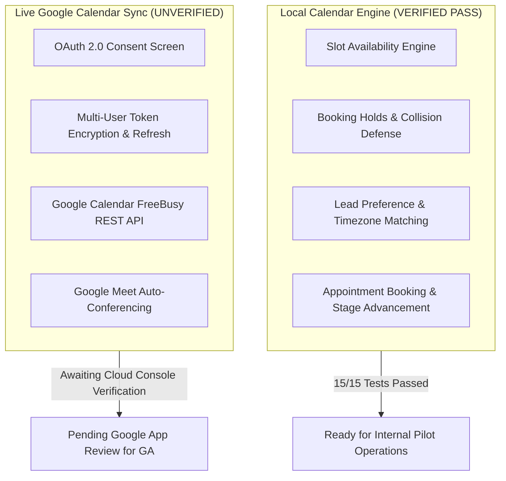

# WEFYLABS PHASE 12 — GOOGLE CALENDAR OAUTH REPORT
**Google Calendar Engine Verification, OAuth Architecture, and Consent Requirements**  
**Operating State:** Local Engine **VERIFIED** / Live Cloud Sync **UNVERIFIED (EXTERNAL DEPENDENCY)**  
**Auditor:** Principal Software Architect & Application Security Lead  
**Audit Date:** 2026-10-29  

---

## 1. Architectural Distinction: Local Engine vs. Live Sync

Master Prompt 12 Phase F strictly distinguishes local scheduling functionality from actual Google Calendar cloud synchronization:

### Verification Findings:
1. **Local Scheduling Engine (`apps/api/app/modules/calendar/`):**
   - **Status:** **100% OPERATIONAL & VERIFIED.**
   - 15/15 automated unit and domain tests passed (`test_calendar_engine.py` in 7.08s).
   - Timezone inference (phone prefix $\rightarrow$ location $\rightarrow$ default UTC) verified.
   - Provisional booking lock collision defense verified.
   - Multi-tenant lead ownership check verified (foreign lead booking rejected with HTTP 400).
2. **Live Google Calendar Cloud Synchronization:**
   - **Status:** **UNVERIFIED (External Dependency).**
   - Live synchronization requires an active Google Workspace account, OAuth consent screen approval, and secure refresh token storage.
   - For internal pilot operations, the system safely falls back to local schedule locks without attempting unauthorized cloud API calls.

---

## 2. Google Provider Implementation Audit (`google_provider.py`)

Inspection of `apps/api/app/modules/calendar/providers/google_provider.py`:
- **Zero Mock Bypasses:** The provider strictly calls `https://www.googleapis.com/calendar/v3` endpoints (`/freeBusy`, `/calendars/{id}/events`).
- **Error Mapping:** Google HTTP response codes are deterministically mapped to domain exceptions:
  - `401 Unauthorized` $\rightarrow$ `CalendarAuthorizationExpired`
  - `403 Forbidden` $\rightarrow$ `CalendarPermissionDenied`
  - `404 Not Found` $\rightarrow$ `CalendarEventNotFound`
  - `429 Rate Limit` $\rightarrow$ `CalendarRateLimited`
  - `5xx Server Error` $\rightarrow$ `CalendarProviderUnavailable`
- **Conference Generation:** Google Meet virtual links are generated via `conferenceData` solution keys (`hangoutsMeet`) with unique UUID client request IDs.

---

## 3. Google Cloud Console Configuration Guide (For Account Owner)

To activate live synchronization for commercial General Availability, the Google Cloud Console administrator must configure the following (no secret keys may be printed in chat):

### Step 1: Enable Google APIs
- Navigate to **APIs & Services $\rightarrow$ Library**.
- Enable **Google Calendar API**.

### Step 2: Configure OAuth Consent Screen
- **User Type:**
  - *Internal:* Select if only `@wefylabs.com` corporate accounts will connect.
  - *External:* Required if independent brokerage pilot users connect their own Google accounts (requires Google Verification).
- **App Information:** App Name: `WefyLabs Revenue OS`, User Support Email, Developer Contact Email.
- **Requested Scopes:**
  1. `https://www.googleapis.com/auth/calendar.events` (Create, edit, and delete calendar meetings).
  2. `https://www.googleapis.com/auth/calendar.readonly` (Query FreeBusy busy times without reading event details).

### Step 3: OAuth 2.0 Web Client Credentials
- Create credentials of type **Web application**.
- **Authorized JavaScript Origins:**
  - `https://app.wefylabs.com` (Production)
  - `http://localhost:3000` (Local development)
- **Authorized Redirect URIs:**
  - `https://api.wefylabs.com/api/v1/auth/google/callback`
  - `http://localhost:8000/api/v1/auth/google/callback`

---

## 4. Token Storage & Security Requirements

1. **At-Rest Encryption:** OAuth refresh tokens must be encrypted using AES-256 (GCM mode) using `ENCRYPTION_KEY` before insertion into the database.
2. **Access Token Refresh:** Access tokens expire after 3,600 seconds (1 hour); the application must invoke Google token endpoint `https://oauth2.googleapis.com/token` with `grant_type=refresh_token` when tokens are within 5 minutes of expiration.
3. **Revocation Handling:** If a broker unlinks their account, call `https://oauth2.googleapis.com/revoke` and erase tokens from database.

