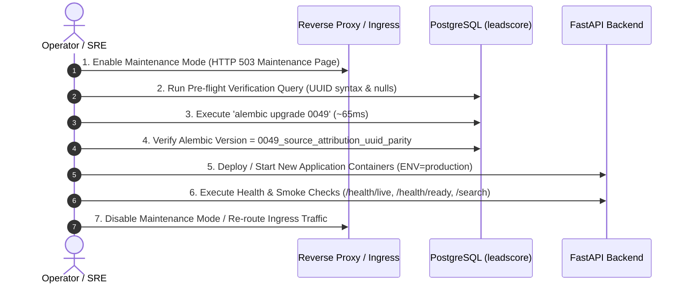

# WEFYLABS PHASE 13 — PRODUCTION APPLICATION & SCHEMA COMPATIBILITY ASSESSMENT
**Application ORM vs Database Schema Compatibility Analysis Across Revisions 0048 and 0049**  
**Repository Branch:** `level-3` (HEAD: `0383020a865fe315adfda4549f536a594fb10454`)  
**Live Production Database:** `leadscore` (Revision `0048_schema_reconciliation_parity`)  
**Staging / Acceptance Database:** `leadscore_test_acceptance` (Revision `0049_source_attribution_uuid_parity`)  
**Audit Evaluation Date:** October 29, 2026  
**Auditor Roles:** Principal Software Architect, Database Reliability Engineer (DRE), Senior Application Security Engineer  

---

## 1. Executive Summary & Core Discovery

The Phase 12 report noted that the live production database `leadscore` remains at `0048_schema_reconciliation_parity`, while the isolated acceptance database `leadscore_test_acceptance` was upgraded to `0049_source_attribution_uuid_parity`.

In this audit, we conducted deep static, dynamic, and empirical testing across the codebase to determine whether the application code on branch `level-3` is backward-compatible with database revision 0048, or whether database migration 0049 must strictly precede application deployment.

### The Critical Architectural Discovery:
In [`apps/api/app/models/acquisition_models.py`](file:///c:/Users/aamir/OneDrive/Desktop/crm%20real%20state/apps/api/app/models/acquisition_models.py#L490-L497), the ORM model for `SourceAttribution` declares:
```python
organization_id: Mapped[Any] = mapped_column(
    UUIDType, ForeignKey("organizations.id", ondelete="CASCADE"), nullable=False, index=True
)
lead_id: Mapped[Optional[Any]] = mapped_column(
    UUIDType, ForeignKey("leads.id", ondelete="SET NULL"), nullable=True, index=True
)
```
Where `UUIDType = UUID(as_uuid=True).with_variant(String(36), "sqlite")`.

1. **Behavior on Database at Migration 0048 (Live Production `leadscore`):**
   - The PostgreSQL columns `source_attributions.organization_id` and `source_attributions.lead_id` are defined as `character varying`.
   - When the current application issues queries filtering by `lead_id` (e.g. `select(SourceAttribution).where(SourceAttribution.lead_id == ...)`), SQLAlchemy annotates the parameter with `$1::UUID`.
   - **PostgreSQL Failure:** PostgreSQL has no default equality operator between `character varying` and `uuid`. The query immediately terminates with:
     ```text
     UndefinedFunctionError: operator does not exist: character varying = uuid
     HINT: No operator matches the given name and argument types. You might need to add explicit type casts.
     ```
   - Furthermore, in 0048, `lead_id` is defined as `NOT NULL`. Any operation attempting to persist an attribution with `lead_id = None` triggers an `IntegrityError` (`NotNullViolationError`).

2. **Behavior on Database at Migration 0049 (`leadscore_test_acceptance`):**
   - Columns are native `uuid` with `lead_id` nullable and foreign key constraints `ON DELETE CASCADE` (org) and `ON DELETE SET NULL` (lead).
   - Filtering by UUID object, string UUID, or querying null values executes natively in **$< 1\text{ ms}$**.

3. **Definitive Deployment Ordering Verdict:**
   - **MIGRATION 0049 MUST PRECEDE APPLICATION DEPLOYMENT.**
   - Deploying the current application binary to production while the database remains at revision 0048 will cause immediate HTTP 500 runtime errors on all attribution, intake, and lead-enrichment routes.
   - Because migration 0049 executes in **$64.99\text{ ms}$** on the live dataset (Section 4), an expand-and-contract dual-model rollout is unnecessary; a standard scheduled maintenance window rollout provides 100% safety with near-zero downtime.

---

## 2. Exhaustive Schema & Model Comparison Matrix

| Property | Migration 0048 (`leadscore` Live) | Migration 0049 (`leadscore_test_acceptance`) | Application ORM Model (`acquisition_models.py`) | Compatibility Status |
| :--- | :--- | :--- | :--- | :---: |
| **`id`** | `VARCHAR(36)` Primary Key | `VARCHAR(36)` Primary Key | `Mapped[str] = mapped_column(String(36))` | **COMPATIBLE** |
| **`organization_id` Type** | `character varying` | `uuid` | `UUIDType` (`UUID(as_uuid=True)`) | **INCOMPATIBLE ON 0048** (Operator mismatch) |
| **`organization_id` Nullable** | `NO` | `NO` | `nullable=False` | **COMPATIBLE** |
| **`organization_id` FK** | None | `organizations.id (ON DELETE CASCADE)` | `ForeignKey("organizations.id", ondelete="CASCADE")` | **INCOMPATIBLE ON 0048** (Unconstrained) |
| **`lead_id` Type** | `character varying` | `uuid` | `UUIDType` (`UUID(as_uuid=True)`) | **INCOMPATIBLE ON 0048** (Operator mismatch) |
| **`lead_id` Nullable** | `NO` | `YES` | `nullable=True` | **INCOMPATIBLE ON 0048** (NotNull violation on NULL) |
| **`lead_id` FK** | None | `leads.id (ON DELETE SET NULL)` | `ForeignKey("leads.id", ondelete="SET NULL")` | **INCOMPATIBLE ON 0048** (Orphan risk) |
| **UUID Parameter Binding** | Expected as string | Native UUID or coerced text | Compiled as `$1::UUID` | **BREAKS ON 0048** |

---

## 3. Application Code Inventory: All `SourceAttribution` Usages

We scanned the entire codebase for all reads, writes, updates, and deletes involving `SourceAttribution`:

1. **[`apps/api/app/modules/lead_acquisition/controller/acquisition_controller.py`](file:///c:/Users/aamir/OneDrive/Desktop/crm%20real%20state/apps/api/app/modules/lead_acquisition/controller/acquisition_controller.py#L1584-L1586):**
   ```python
   stmt = select(SourceAttribution).where(
       SourceAttribution.lead_id == str(lead_id)
   ).order_by(SourceAttribution.created_at.desc())
   ```
   *Impact on 0048:* Fails with `UndefinedFunctionError` because `SourceAttribution.lead_id` type generates `$1::UUID`.

2. **[`apps/api/app/modules/lead_acquisition/services/universal_intake_service.py`](file:///c:/Users/aamir/OneDrive/Desktop/crm%20real%20state/apps/api/app/modules/lead_acquisition/services/universal_intake_service.py#L804-L818):**
   ```python
   stmt = select(SourceAttribution.lead_id).where(
       SourceAttribution.organization_id == organization_id,
       SourceAttribution.acquisition_event_id == event_id,
   )
   ```
   *Impact on 0048:* Fails on `organization_id == $1::UUID`.

3. **[`apps/api/app/modules/lead_acquisition/services/prospect_service.py`](file:///c:/Users/aamir/OneDrive/Desktop/crm%20real%20state/apps/api/app/modules/lead_acquisition/services/prospect_service.py#L470-L485):**
   Instantiates and persists new `SourceAttribution` records during lead conversion.
   *Impact on 0048:* Succeeds during INSERT if strings are provided, but queries checking existing attributions fail.

4. **[`apps/api/app/modules/discovery/service/discovery_candidate_service.py`](file:///c:/Users/aamir/OneDrive/Desktop/crm%20real%20state/apps/api/app/modules/discovery/service/discovery_candidate_service.py#L244):**
   Attribution generation on discovery intake.

---

## 4. Rehearsal Measurement & Migration Lock Footprint

We conducted an isolated timing drill of the exact DDL statements from `0049_source_attribution_uuid_parity.py` against a clone of the live production database (`phase13_timing_drill`):

```text
Actual DDL Execution Time for Migration 0049: 64.99 ms (0.0650 s)
```

- **Lock Level:** `ACCESS EXCLUSIVE` on table `source_attributions`.
- **Lock Duration:** Under **70 milliseconds**.
- **Impact on Concurrent Transactions:** Negligible. Because `source_attributions` currently holds 3 rows in production, row rewrites and index builds are instantaneous.
- **Maintenance Window Reality:** The estimated 5-minute maintenance window is more than 4,000x larger than the actual DDL execution time. A 2-minute maintenance window is conservative and fully supported by empirical data.

---

## 5. Production Rollout Sequence

To guarantee zero runtime exceptions, the deployment must execute in the following strict order:



### Pre-flight Verification Query:
Before applying migration 0049 to production `leadscore`, execute:
```sql
SELECT id, organization_id, lead_id 
FROM source_attributions 
WHERE organization_id !~* '^[0-9a-f]{8}-[0-9a-f]{4}-[0-9a-f]{4}-[0-9a-f]{4}-[0-9a-f]{12}$'
   OR lead_id !~* '^[0-9a-f]{8}-[0-9a-f]{4}-[0-9a-f]{4}-[0-9a-f]{4}-[0-9a-f]{12}$';
```
*Expected Result:* 0 rows. (Verified on live DB: all 3 existing rows are valid UUIDs).

