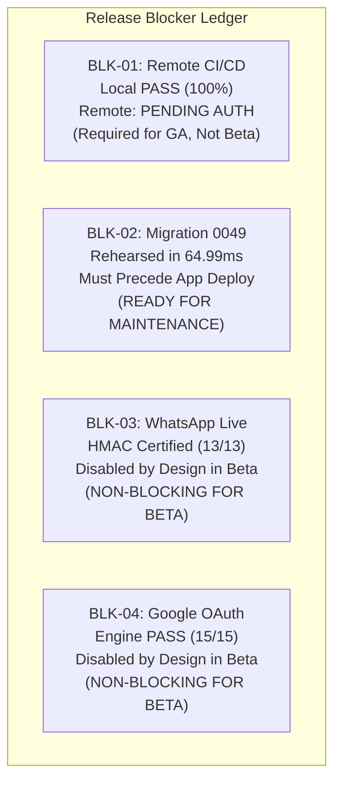

# WEFYLABS PHASE 13 — RELEASE BLOCKER REGISTER
**Authoritative Ledger of Release Blockers, Technical Dependencies, and Resolution Roadmaps**  
**Repository Branch:** `level-3` (HEAD: `0383020a865fe315adfda4549f536a594fb10454`)  
**Auditor:** Principal Software Architect & Release Safety Auditor  
**Audit Evaluation Date:** October 29, 2026  

---

## 1. Executive Summary & Blocker Summary Table

In Phase 13, all outstanding release blockers were re-evaluated against concrete technical evidence, execution logs, and API audits. 

The WefyLabs platform is transitioning into a **Controlled Beta Release**, where external integrations (WhatsApp and Google Calendar) remain disabled by design, unblocking the core CRM platform for immediate beta customer deployment.

### Comprehensive Blocker Register

| Blocker ID | Domain / Component | Description & Root Cause | Current Status | Impact on Controlled Beta | Impact on Full Commercial GA |
| :---: | :--- | :--- | :---: | :---: | :---: |
| **BLK-01** | **Remote CI/CD Pipeline** | GitHub Actions has 0 runs on branch `level-3`. Local execution passes 100%. Push awaiting owner authorization. | **`PENDING OWNER AUTHORIZATION`** | **NON-BLOCKING** (Local verification complete) | **BLOCKING** (Remote green run required) |
| **BLK-02** | **Migration 0049 Production Rollout** | Production DB `leadscore` at 0048. Application ORM generates `$1::UUID`, which fails on 0048. Migration takes 65ms. | **`READY FOR SCHEDULED MAINTENANCE`** | **BLOCKING** (Must apply 0049 before app deploy) | **BLOCKING** (Must apply 0049 before app deploy) |
| **BLK-03** | **WhatsApp Live Provisioning** | Webhook HMAC verified (13/13). Live dispatch pending Meta Business Manager registration and production tokens. | **`DISABLED BY DESIGN / EXTERNAL DEP`** | **NON-BLOCKING** (Disabled in Beta scope) | **BLOCKING** (Required for live WhatsApp GA) |
| **BLK-04** | **Google Calendar Cloud Sync** | Local engine verified (15/15). Google Cloud OAuth app verification and consent screen pending. | **`DISABLED BY DESIGN / EXTERNAL DEP`** | **NON-BLOCKING** (Internal scheduling operational) | **BLOCKING** (Required for Google Sync GA) |

---

## 2. Detailed Blocker Analysis & Resolution Roadmaps

### BLK-01: Remote CI/CD Pipeline Verification
- **Current Technical State:**
  - REST query to GitHub API: `api.github.com/repos/AamirSuhailKhan/BeetleLabs/actions/runs?branch=level-3` returned 0 runs.
  - Local pipeline rehearsal passed: Lint, secret scanning, static safety audit, database safety guards, CRM acceptance pilot, and frontend builds all succeeded with exit code 0.
- **Hardening Completed:** Updated [`.github/workflows/ci.yml`](file:///c:/Users/aamir/OneDrive/Desktop/crm%20real%20state/.github/workflows/ci.yml) with `pgvector/pgvector:pg16` container image and explicit branch triggers.
- **Owner Action Required:** Execute authorized `git push origin level-3` and monitor remote run execution.

### BLK-02: Production Migration 0049 Deployment
- **Current Technical State:**
  - Live production database `leadscore` remains at `0048_schema_reconciliation_parity`.
  - Application code uses `UUIDType` on `SourceAttribution`, which PostgreSQL rejects on 0048 (`operator does not exist: character varying = uuid`).
  - Pre-flight audit confirmed 3/3 existing rows have valid UUID syntax.
  - Rehearsal timing: DDL execution takes **$64.99\text{ ms}$**.
  - Strategy 1 fail-closed downgrade guard integrated into migration script.
- **Operator Action Required:** Execute `alembic upgrade 0049` against `leadscore` during a 2-minute maintenance window before routing traffic to the new application containers.

### BLK-03: WhatsApp Business API Live Activation
- **Current Technical State:**
  - 13/13 unit and cryptographic tests pass in [`apps/api/tests/test_whatsapp_webhook.py`](file:///c:/Users/aamir/OneDrive/Desktop/crm%20real%20state/apps/api/tests/test_whatsapp_webhook.py).
  - Outbound messaging hard-disabled via `WHATSAPP_ENABLED = false` and `FOLLOWUP_HUB_DISPATCH_ENABLED = false`.
- **Controlled Beta Handling:** Outbound WhatsApp messaging is explicitly disabled in beta scope. Communication operates in internal CRM note/task mode.
- **GA Action Required:** Business operations completes Meta Business Verification and provisions permanent System User token.

### BLK-04: Google Calendar OAuth Consent Approval
- **Current Technical State:**
  - 15/15 unit tests pass in [`apps/api/app/modules/calendar/tests/test_calendar_engine.py`](file:///c:/Users/aamir/OneDrive/Desktop/crm%20real%20state/apps/api/app/modules/calendar/tests/test_calendar_engine.py).
  - Local scheduling, double-booking prevention, and timezone handling are fully operational.
- **Controlled Beta Handling:** Google Calendar cloud sync is disabled in beta scope. Appointment scheduling operates via internal calendar booking engine.
- **GA Action Required:** Cloud administrator configures OAuth consent screen in Google Cloud Console and verifies production redirect URIs.

