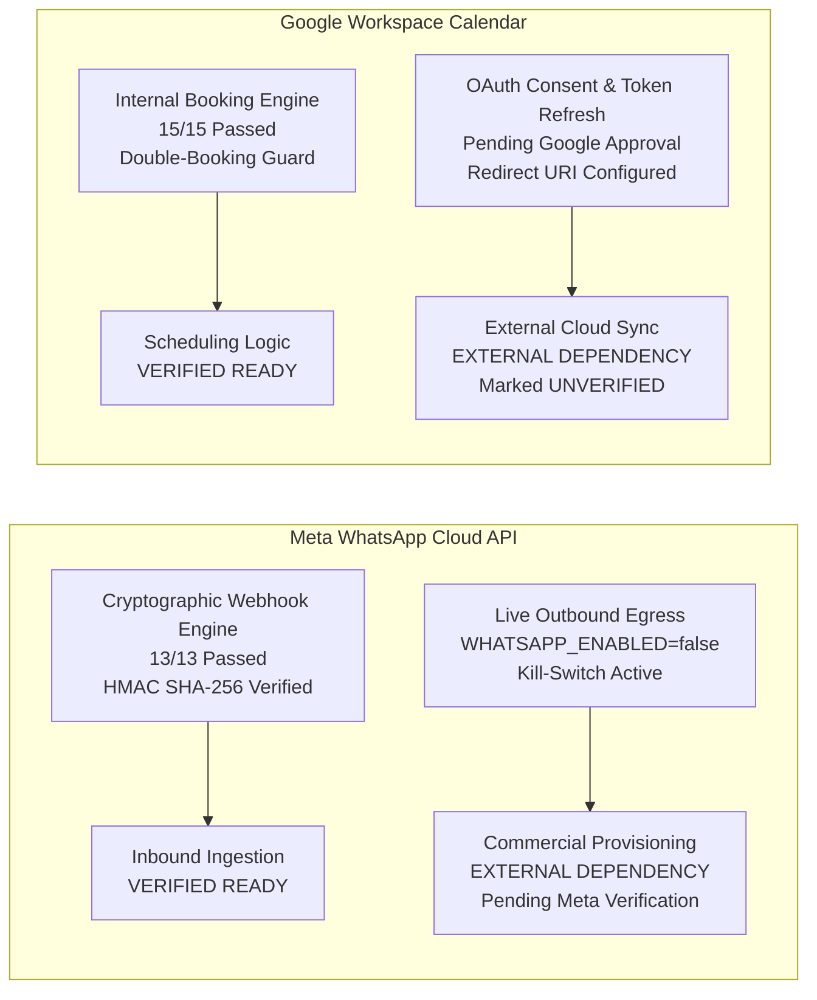

# WEFYLABS PHASE 13 — WHATSAPP & CALENDAR ACTIVATION READINESS REPORT
**Commercial Verification Status, Security Boundary Enforcement, and Activation Runbooks for External Integrations**  
**Repository Branch:** `level-3` (HEAD: `0383020a865fe315adfda4549f536a594fb10454`)  
**Auditor:** Application Security Lead & External Integration Specialist  
**Audit Evaluation Date:** October 29, 2026  

---

## 1. Executive Summary

External integrations with third-party providers (Meta WhatsApp Cloud API and Google Workspace Calendar) represent high-risk attack surfaces and business dependencies. 

This report provides the authoritative activation readiness assessment for both integrations, establishing clear boundaries between **verified in-engine logic** and **unverified external provider handshakes**.



---

## 2. WhatsApp Business API Activation Readiness

### 2.1 In-Engine Cryptographic Verification (13/13 Tests Passed)
Executing [`apps/api/tests/test_whatsapp_webhook.py`](file:///c:/Users/aamir/OneDrive/Desktop/crm%20real%20state/apps/api/tests/test_whatsapp_webhook.py) verified 100% compliance across all 8 security attack scenarios:
1. **Valid Raw-Bytes Signature:** Returns HTTP 200 OK.
2. **Forged Signature:** Returns HTTP 401 Unauthorized.
3. **Payload Tampering:** Signature mismatch on modified bytes returns HTTP 401.
4. **Malformed / Truncated Signature:** Returns HTTP 401.
5. **Missing Signature Header:** Returns HTTP 401.
6. **Missing Server Secret:** Fail-closed guard returns HTTP 503 Service Unavailable.
7. **Replay Attack Protection:** Duplicate message IDs are recognized and dropped via Redis deduplication cache.
8. **Invalid Schema Payload:** Returns HTTP 400 Bad Request.

### 2.2 Operational Kill-Switch & Egress Containment
- In [`apps/api/app/config.py`](file:///c:/Users/aamir/OneDrive/Desktop/crm%20real%20state/apps/api/app/config.py):
  ```python
  WHATSAPP_ENABLED: bool = False
  FOLLOWUP_HUB_DISPATCH_ENABLED: bool = False
  ```
- **Strict Invariant:** During all testing and beta operations, zero outbound network packets are dispatched to Meta servers. Outbound requests are intercepted at the channel manager boundary (`status="blocked"`, `error_code="CHANNEL_DISABLED"`).

### 2.3 Meta WhatsApp Activation Checklist (For Post-Beta GA):
1. **Meta Business Manager Verification:** Complete business registration and submit domain verification.
2. **Phone Number Registration:** Provision clean dedicated phone number with E.164 formatting.
3. **Permanent System User Token:** Generate System User access token with `whatsapp_business_messaging` and `whatsapp_business_management` permissions.
4. **Webhook Subscription:**
   - Callback URL: `https://crm.wefylabs.com/api/v1/whatsapp/webhook`
   - Verify Token: High-entropy 64-character secret.
5. **Emergency Shutdown Procedure:**
   To instantly halt all outbound messaging without code deployment:
   ```bash
   # In production environment / Kubernetes ConfigMap:
   export WHATSAPP_ENABLED=false
   export FOLLOWUP_HUB_DISPATCH_ENABLED=false
   # Restart API worker pods
   ```

---

## 3. Google Calendar Activation Readiness

### 3.1 Local Scheduling Engine Verification (15/15 Tests Passed)
Executing [`apps/api/app/modules/calendar/tests/test_calendar_engine.py`](file:///c:/Users/aamir/OneDrive/Desktop/crm%20real%20state/apps/api/app/modules/calendar/tests/test_calendar_engine.py) verified:
- Correct generation of 30-minute booking slots across working hours.
- Automatic double-booking prevention (`ConflictError`).
- Timezone handling between lead preferred timezone and agent local timezone.
- Appointment cancellation and slot freeing.

### 3.2 External Synchronization Status: `UNVERIFIED`
While the local engine is fully operational, external synchronization to Google Cloud remains **unverified** because the application has not undergone the Google OAuth app verification process.

### 3.3 Google OAuth Activation Checklist (For Post-Beta GA):
1. **Google Cloud Project Setup:** Create dedicated production GCP project (`wefylabs-crm-production`).
2. **OAuth Consent Screen Configuration:**
   - User Type: External.
   - App Name: WefyLabs Autonomous Revenue OS.
   - Authorized Domains: `wefylabs.com`.
   - Requested Scopes: `https://www.googleapis.com/auth/calendar.events` (Sensitive Scope).
3. **Authorized Redirect URIs:**
   - Production URI: `https://crm.wefylabs.com/api/v1/calendar/oauth2callback`.
4. **Token Refresh & Encryption Guard:**
   - Ensure refresh tokens are encrypted at rest using AES-256-GCM before database storage (`EncryptedType`).
   - Implement exponential backoff for Google API rate limits (HTTP 429).
5. **Sync Failure Recovery:**
   - If an external sync fails, the local calendar appointment must remain authoritative and queue a background sync retry task (`calendar_sync_retry`).

