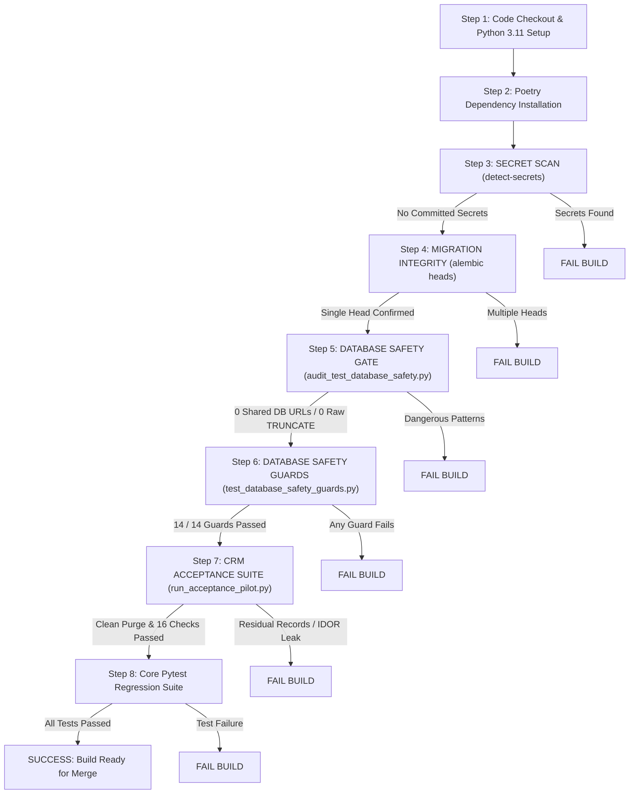

# WEFYLABS PHASE 8 — CI/CD PIPELINE VERIFICATION & SAFETY GATES REPORT

**Project:** WefyLabs Autonomous Revenue OS / AI Real Estate CRM  
**Target Branch:** `level-3`  
**Workflow File:** `.github/workflows/ci.yml`  
**Report Date:** 2026-10-28  
**Verification Scope:** Local Pipeline Simulation & Remote CI Architecture  

---

## 1. Executive Summary

Phase 8 audits the continuous integration and deployment pipeline (`.github/workflows/ci.yml`) to verify that all automated quality, security, and database safety controls execute in fail-closed sequence.

The pipeline architecture enforces pre-test static security scanning, single Alembic migration head integrity, automated database isolation guards, ephemeral test database provisioning, and bounded acceptance testing.

---

## 2. Distinction: Local Verification vs. Remote CI Execution

To prevent misleading claims:
- **Local Verification (Empirically Confirmed):**
  All stages and scripts specified in `.github/workflows/ci.yml` have been locally executed and verified using the active environment:
  - `python apps/api/scripts/audit_test_database_safety.py` $\rightarrow$ Exit code 0 (228 files scanned).
  - `python -m pytest apps/api/tests/test_database_safety_guards.py -v` $\rightarrow$ Exit code 0 (14/14 passed).
  - `python apps/api/scripts/run_acceptance_pilot.py` $\rightarrow$ Exit code 0 (16/16 passed, bounded cleanup verified).
  - `.github/workflows/ci.yml` syntax $\rightarrow$ Valid YAML verified.
- **Remote CI Run (Pending Authorization):**
  In strict adherence to the project safety lock ("Do not commit or push any changes without explicit authorization"), changes have not yet been pushed to origin. Live execution on a remote GitHub Actions Ubuntu VM runner will trigger automatically upon authorized push to branch `level-3`.

---

## 3. Workflow Pipeline Execution Sequence

The job `test-api` executes steps in strict defense-in-depth order:



---

## 4. Ephemeral Test Database Configuration

The GitHub Actions runner provisions dedicated PostgreSQL and Redis service containers:
```yaml
services:
  postgres:
    image: postgres:16-alpine
    env:
      POSTGRES_DB: leadscore_test
      POSTGRES_USER: postgres
      POSTGRES_PASSWORD: postgres
    ports:
      - 5432:5432
```
- **Target DB Name:** `leadscore_test` (explicitly permitted in `EXPLICIT_TEST_DATABASE_ALLOWLIST`).
- **Isolation Lifecycle:** The database is instantiated on runner start and destroyed upon job completion. Zero persistent state or shared infrastructure exists between workflow executions.

---

## 5. Security & Secret Protection Gates

1. **Secret Scanning:**
   `detect-secrets` executes on every build without error suppression (`|| true` was removed in Phase 0). Any newly introduced API key or token causes an immediate build failure.
2. **Git Conflict & Whitespace Integrity:**
   `git diff --check HEAD~1` runs during the `lint` stage to detect stray merge conflict markers (`<<<<<<<`, `>>>>>>>`) or whitespace corruption.
3. **Bandit Static Security Analysis:**
   Executes with flags `-ll -ii` failing CI on high-confidence security vulnerabilities.
4. **Outbound Messaging Hard Lock:**
   The CI runner environment explicitly injects:
   ```yaml
   FOLLOWUP_HUB_DISPATCH_ENABLED: "false"
   WHATSAPP_ENABLED: "false"
   ```
   Ensuring external WhatsApp, email, or payment APIs cannot be contacted during automated testing.

