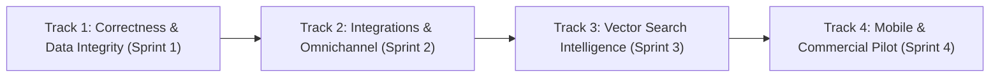

# WEFYLABS PHASE 8 — PRIORITIZED REMEDIATION & PRODUCT ROADMAP

**Project:** WefyLabs Autonomous Revenue OS / AI Real Estate CRM  
**Target Branch:** `level-3`  
**Roadmap Horizon:** Q4 2026 – Q1 2027  
**Planning Date:** 2026-10-28  

---

## 1. Roadmap Architecture & Execution Principles

This roadmap organizes engineering improvements into dependency-aware phases. Correctness, data integrity, and multi-tenant security precede feature expansions or third-party integrations.

---

## 2. Track 1: Correctness & Multi-Tenant Data Integrity (Sprint 1 — Current)

| Priority | Task ID | Description | Impact Area | Status |
| :---: | :--- | :--- | :--- | :---: |
| **P0** | `BUG-RI-01` | Refactor analytical queries in `RevenueIntelligenceService` to use dual-tenant filtering `or_(Lead.organization_id == org_id, Lead.broker_id == org_id)`. | Revenue Dashboards | **COMPLETED (Phase 8)** |
| **P0** | `REG-RI-01` | Add regression test verifying multi-agent lead aggregation across organizations in `test_part11_revenue_intelligence.py`. | Test Coverage | **COMPLETED (Phase 8)** |
| **P1** | `BUG-DB-02` | Prepare Alembic migration `0049_source_attribution_fk` to cast `source_attributions.lead_id` and `organization_id` to native `UUID` and establish cascading foreign-key constraints. | Database Schema | Planned (Sprint 1.2) |
| **P1** | `ARCH-STARTUP-03` | Deprecate implicit `Base.metadata.create_all` during container startup; enforce Alembic single-head migration verification across all environments. | Container Startup | Planned (Sprint 1.2) |

---

## 3. Track 2: Omnichannel Communication & Calendar Sync (Sprint 2)

| Priority | Task ID | Description | Impact Area | Dependencies |
| :---: | :--- | :--- | :--- | :--- |
| **P1** | `FEAT-NOTIF-05` | Connect legacy `WhatsAppChannelAdapter` and `SMSChannelAdapter` in `modules/notifications/` to delegate to `ChannelManager` in `modules/communication/`. | Notifications | Track 1 |
| **P1** | `FEAT-CAL-08` | Implement Google Calendar OAuth2 token exchange and two-way meeting synchronization in `apps/api/app/modules/integrations/`. | Calendar Sync | Google OAuth Credentials |
| **P2** | `FEAT-PORTAL-01` | Implement turnkey webhook parser adapters for regional real estate portals (MagicBricks, 99acres, Bayut, PropertyFinder). | Lead Ingestion | Universal Intake Service |

---

## 4. Track 3: Vector Search & Property Intelligence (Sprint 3)

| Priority | Task ID | Description | Impact Area | Dependencies |
| :---: | :--- | :--- | :--- | :--- |
| **P1** | `ARCH-SEARCH-07` | Implement native `VectorSearchProvider` leveraging the existing PostgreSQL pgvector extension and `ix_ke_vector_hnsw` index. | Property Search | PostgreSQL pgvector |
| **P2** | `ML-RECOMMEND-02` | Enhance natural language property query embeddings using Gemini 2.5 Flash for sub-second semantic matching against inventory. | AI Recommendations | Gemini API Adapter |

---

## 5. Track 4: Frontend Polish & Mobile Field Workflows (Sprint 4)

| Priority | Task ID | Description | Impact Area | Dependencies |
| :---: | :--- | :--- | :--- | :--- |
| **P2** | `DEP-WEB-09` | Update `@types/react` and `@types/react-dom` to `^19.0.0` in `apps/web/package.json`. | Web Frontend | Next.js 15.5 |
| **P2** | `FEAT-MOBILE-01` | Implement PWA / offline-first caching for site visit agent inspection notes with automatic background sync when reconnected. | Mobile Web | Service Workers |

---

## 6. Definition of Done for Future Releases

A feature or remediation is considered production-ready only when:
1. All database mutations occur within validated test databases approved by `validate_test_database_target`.
2. Static database safety checks (`audit_test_database_safety.py`) pass with 0 critical violations.
3. Automated unit and regression tests pass with 100% success rate without error suppression.
4. Schema modifications are accompanied by an immutable Alembic migration script maintaining a single revision head.
5. Outbound communication channels fail closed unless explicitly activated by authorized administrator credentials.

